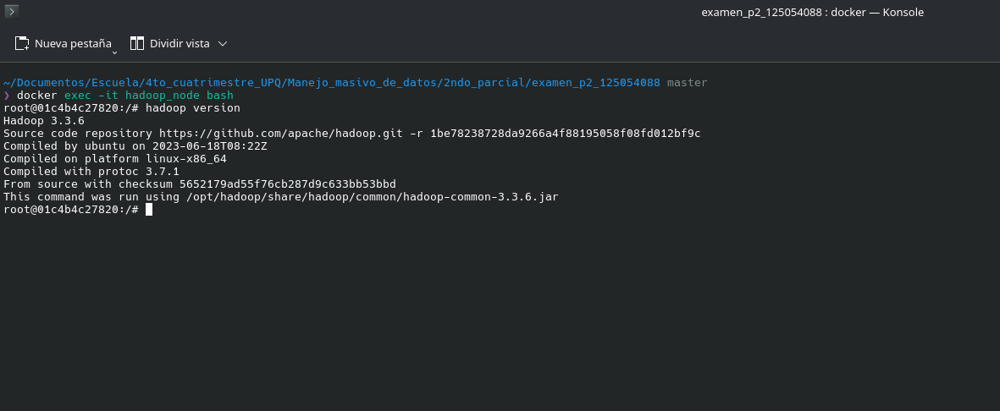
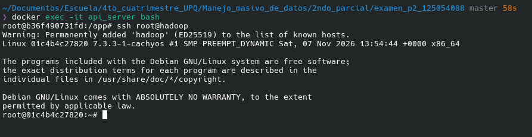
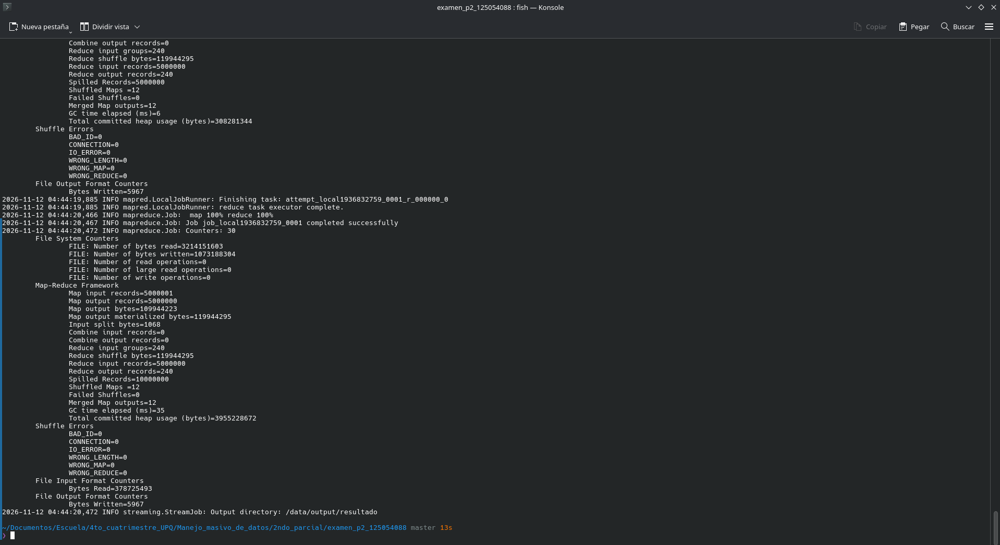
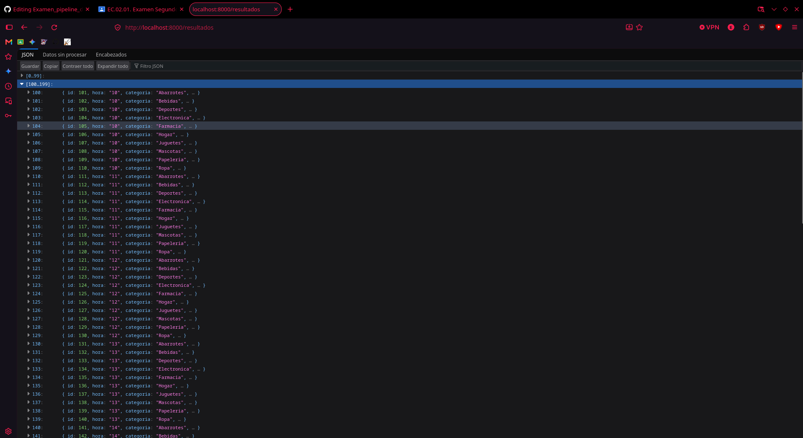

## Parte E: Respuestas Teóricas

## Pasos para reproducir el pipeline
1. **Generar el dataset:** Ejecutar `python generar_dataset.py` e ingresar la matrícula para crear el archivo CSV.
2. **Levantar el entorno:** Ejecutar `docker compose up -d --build` para encender Hadoop, PostgreSQL y la API.
3. **Pasar scripts a Hadoop:**
   ```bash
   docker cp hadoop/mapreduce/mapper.py hadoop_node:/mapper.py
   docker cp hadoop/mapreduce/reducer.py hadoop_node:/reducer.py
4. **Ejecutar el procesamiento MapReduce:**
   ```bash
   docker exec -it hadoop_node bash -c "cd / && hadoop jar \$HADOOP_HOME/share/hadoop/tools/lib/hadoop-streaming-3.3.6.jar -files mapper.py,reducer.py -mapper 'python3 mapper.py' -reducer 'python3 reducer.py' -input /data/input/ventas_125054088.csv -output /data/output/resultado"
5. **Extraer y cargar a la base de datos:**
   ```bash
   docker cp hadoop_node:/data/output/resultado/part-00000 ./part-00000
   docker cp ./part-00000 api_server:/app/part-00000
   docker cp cargar_resultados.py api_server:/app/cargar_resultados.py
   docker exec -it api_server python cargar_resultados.py

**1. Modos de Hadoop y HDFS**
El modo *standalone* usa un solo proceso Java sin demonios y utiliza el sistema de archivos local (ideal para testear scripts rápido). El *pseudo-distribuido* corre todos los demonios (NameNode, DataNode) simulados en una sola máquina física. El *totalmente distribuido* reparte estos demonios en un clúster de múltiples servidores. HDFS se utiliza únicamente en los modos pseudo-distribuido y totalmente distribuido.

**2. Volumen vs COPY para el Dataset**
El dataset se monta como volumen por dos razones: 1) Evitar inflar el peso de la imagen de Docker empaquetando 400 MB estáticos innecesarios, y 2) Permitir intercambiar o actualizar el archivo CSV desde el sistema host sin tener que reconstruir la imagen de Hadoop (`docker build`) cada vez que cambien los datos.

**3. docker compose stop vs down**
Al ejecutar `stop`, los contenedores simplemente se detienen (pausan) pero siguen existiendo. Al ejecutar `down`, los contenedores y la red interna se destruyen. En ambos casos, los datos de la base de datos *persisten* y no se pierden porque configuramos un volumen nombrado (`pgdata`). Solo se perderían si forzamos el borrado del volumen con `docker compose down -v`.

**4. Velocidad de MapReduce vs Secuencial**
MapReduce no es más rápido con archivos pequeños (400 MB) porque gasta demasiado tiempo en sobrecarga (overhead): levantando la JVM, mapeando memoria y ejecutando el pesado proceso de "Shuffle and Sort" escribiendo a disco local. MapReduce empieza a ser superior cuando el archivo es tan gigantesco que ya no cabe en la memoria RAM de una sola máquina y requiere forzosamente dividirse y procesarse en múltiples nodos.

**5. CMD vs ENTRYPOINT y COPY vs ADD**
`COPY` solo transfiere archivos locales al contenedor, mientras que `ADD` tiene funciones extra como descomprimir archivos `.tar` automáticamente y descargar desde URLs. Por otro lado, `CMD` define el comando por defecto al iniciar (fácilmente sobreescribible en la terminal al correr el contenedor), mientras que `ENTRYPOINT` fija el ejecutable principal inamovible que el contenedor utilizará siempre.

## Evidencias (Capturas de pantalla)
A continuación se muestran las evidencias de la correcta ejecución de cada componente del pipeline:

* **Hadoop Version:** 
  

* **SSH sin contraseña (API a Hadoop):** 
  

* **Salida exitosa del Job MapReduce:** 
  

* **Respuesta de la API (GET /resultados):** 
  
